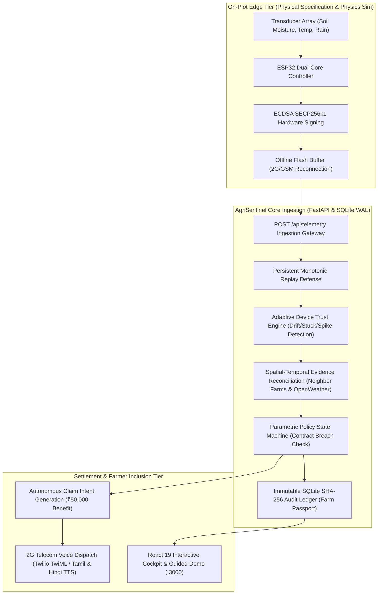

# AgriSentinel 🌾
> **Autonomous Parametric Crop Insurance & Hardware-Signed IoT Telemetry Platform**

AgriSentinel is a prototype parametric crop insurance platform that tackles **Basis Risk** in smallholder agriculture. By evaluating micro-climates directly at the farm fence line with cryptographically authenticated IoT telemetry, adaptive device trust scoring, and spatial evidence reconciliation, AgriSentinel enables rapid, verifiable claim decisions without multi-month audit delays.

> [!NOTE]
> **Hardware & Deployment Status**: AgriSentinel is currently an engineering prototype and software simulation testbed. The physical on-farm edge node is fully specified (OpenSCAD 3D enclosure model, circuit schematic, sensor suite, BOM target) and modeled via a 9-node thermodynamic physics simulation engine with authentic ECDSA SECP256k1 signing. Physical hardware deployment and monetary underwriting integration are planned for future field pilots.

---

## 🚀 Quick Start (Zero Setup Hassle)

### Step 1: Clone Repository
```bash
git clone https://github.com/Thishanth-T/Agrisentinel.git
cd Agrisentinel
```

### Step 2: One-Time Environment Setup
* **Windows**: Double-click **`setup_env.bat`** (or open terminal and run `pip install -r requirements.txt`).
* **macOS / Linux**: Run `./setup_env.sh` (or `pip3 install -r requirements.txt && (cd frontend && npm install)`).

### Step 3: Run Platform in 1-Click
* **Windows**: Double-click **`start_agrisentinel.bat`**
* **macOS / Linux**: Run `./start_agrisentinel.sh`

The launcher automatically starts:
1. **FastAPI Ingestion Engine**: `http://localhost:8000` (API Swagger docs at `/docs`)
2. **Animated React Web Interface**: `http://localhost:3000`
3. *(Optional)* **Streamlit Operations Cockpit**: `streamlit run Agrisentinel/dashboard.py` (available on `http://localhost:8501`)

To terminate running services:
* **Windows**: Double-click `stop_agrisentinel.bat`
* **macOS / Linux**: Run `./stop_agrisentinel.sh` (or press `Ctrl+C`)

---

## 🎬 Guided 3-Minute Hackathon Demo Mode
AgriSentinel includes an integrated, interactive **7-Step Hackathon Guided Walkthrough** accessible directly on `http://localhost:3000`:
- Click **"▶ Run 3-Min Demo"** in the top navigation bar or the hero showcase card.
- Steps through: *Pan-India Baseline &rarr; 85mm Cloudburst Influx &rarr; Basis Risk Paradox &rarr; SECP256k1 Curve Verification &rarr; Instant ₹50,000 Parametric Claim &rarr; 2G Regional Voice Dispatch (in-browser Tamil/English TTS) &rarr; Immutable SHA-256 Hash-Chain Audit*.
- Each step triggers live backend API calls and displays real-time cryptographic logs and SQLite block transactions.

---

## 🧪 Running the Automated Verification Suite

AgriSentinel includes 49 automated test cases covering cryptographic integrity, replay defense, hardware fault injection, and spatial reconciliation. With root `pytest.ini`, tests run out of the box with zero configuration:

```bash
# 1. Run all 34 acceptance and validation gates via pytest:
pytest

# 2. Run the 15 zero-dependency offline integration tests:
python tests/run_tests.py
```

---

## 🏗️ System Architecture & Data Flow



---

## 🛠️ Architectural Components

- **Cryptographic Anti-Fraud Engine (`crypto_engine.py`)**: ECDSA SECP256k1 signatures verify that incoming sensor telemetry originates from provisioned hardware keys. Enforces monotonic sequence numbers and persistent SHA-256 replay defense across backend restarts.
- **Adaptive Device Trust Engine (`evidence_reconciliation.py`)**: Continuously monitors transducer health, battery headroom, historical variance, and sudden moisture jumps. Downgrades trust when sensor faults (stuck/drift/spike) are detected, preventing compromised hardware from triggering false claims.
- **Spatial-Temporal Evidence Reconciliation (`evidence_reconciliation.py`)**: Cross-references plot measurements against neighboring farms and independent regional meteorological stations (OpenWeatherMap API / calibrated agro-climatic baseline) to corroborate localized cloudbursts and drought desiccation.
- **Immutable Audit Trail (`database.py`)**: Transactional SQLite database with SHA-256 hash-linked blocks (`audit_log` table) guaranteeing tamper-evident chain of custody.
- **Regional Telecom Voice Dispatch (`telecom_service.py`)**: Generates localized TwiML voice XML in Tamil, Hindi, and regional languages with DTMF keypad confirmation without requiring a smartphone or internet connection.
- **Agronomic Advisory Service (`advisor_service.py`)**: Ground-truth ICAR/KVK-calibrated crop recommendations with explicit pesticide spray cautions, enhanced via Groq LLaMA-3.3-70B with offline deterministic fallback.

---

## 🤖 AI Tool Disclosure (HackWithAditya Rule Compliance)

In compliance with **HackWithAditya 2026 Contest Rule 5 (AI Disclosure)**:
- **AI Tools Utilized**: Anthropic Claude & Google Gemini (via Antigravity IDE) were utilized as assistive coding, debugging, documentation, and frontend styling copilots.
- **Human Authorship & Core Engineering**: All core architectural decisions, cryptographic protocols (SECP256k1 curve enforcement), spatial-temporal reconciliation algorithms, parametric policy state machines, OpenSCAD CAD parametric modeling, and Godot 4 simulation logic were designed, implemented, and verified by the team (`saileshmv05` & `Thishanth T`).

---

## 🧊 3D Hardware Specification (OpenSCAD)

The physical AgriSentinel enclosure model is located in [`Agrisentinel 3D model/`](file:///d:/agri%20sentinels/Agrisentinel%203D%20model/).
To view and render the model:
1. Download [OpenSCAD](https://openscad.org/downloads.html).
2. Open [`AgriSentinel_3D_Model_WIRED.scad`](file:///d:/agri%20sentinels/Agrisentinel%203D%20model/AgriSentinel_3D_Model_WIRED.scad).
3. Press **F5** to preview or **F6** to render.

---

## 🎮 Godot 4 Simulation Grid (Optional)

To interact with the visual 50m × 50m farm simulation:
1. Open **Godot 4**.
2. Click **Import** → Select the `godot_simulator` folder.
3. Press **F5** to run the 2D environmental grid simulator with live signing.
